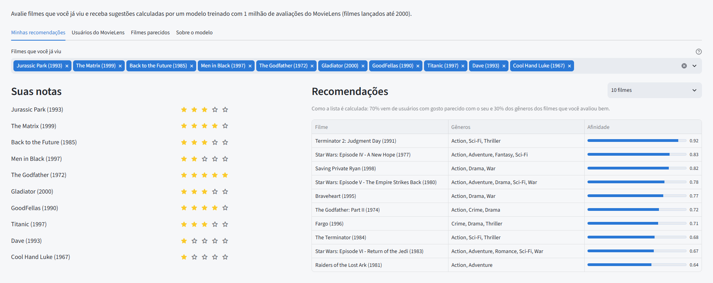
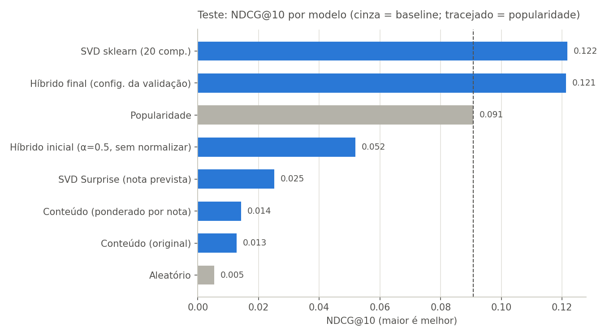
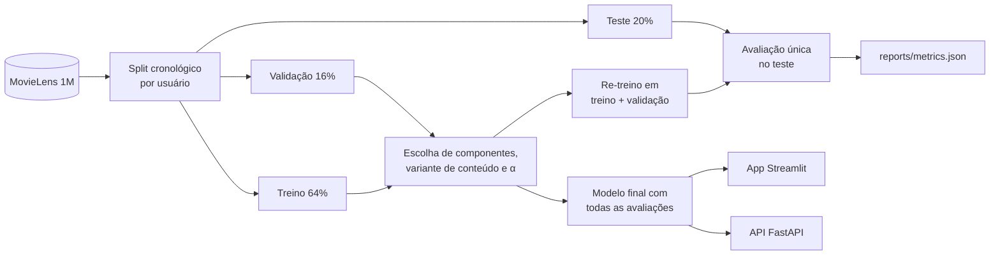

# Sistema de Recomendação de Filmes

[](https://github.com/nuss44/sistema-recomendacao-filmes/actions/workflows/ci.yml)

[](LICENSE)

Recomendador híbrido de filmes treinado com o MovieLens 1M (1 milhão de avaliações de
6.040 usuários sobre 3.883 filmes). Combina fatoração de matrizes, que encontra usuários
com gosto parecido, com similaridade de gêneros, ponderada pelas notas de cada pessoa.
O projeto vai do experimento em notebook a um app interativo, uma API e uma imagem Docker,
com avaliação reprodutível: qualquer pessoa chega ao mesmo modelo e às mesmas métricas
com um comando.



*Notas altas para The Godfather, GoodFellas e The Matrix trazem The Godfather: Part II,
Fargo e Terminator 2, além de filmes próximos do perfil, como Star Wars.*

## Resultados

Avaliação top-10 nas avaliações mais recentes de cada usuário, que nenhum modelo viu
durante o ajuste. Uma recomendação conta como acerto quando o usuário deu nota 4 ou 5 ao
filme.

| Modelo | Precision@10 | Recall@10 | NDCG@10 | Cobertura |
|---|---:|---:|---:|---:|
| **Híbrido final** (SVD + conteúdo, α = 0,7) | **0,0997** | 0,0844 | 0,1213 | **21,9%** |
| SVD (scikit-learn, 20 componentes) | 0,0992 | 0,0847 | **0,1218** | 17,7% |
| Popularidade *(baseline)* | 0,0799 | 0,0473 | 0,0907 | 3,0% |
| Híbrido inicial (α = 0,5, sem normalizar) | 0,0381 | 0,0400 | 0,0520 | 45,7% |
| SVD (Surprise, nota prevista) | 0,0243 | 0,0168 | 0,0252 | 8,6% |
| Conteúdo ponderado por nota | 0,0122 | 0,0094 | 0,0143 | 98,3% |
| Conteúdo (só gêneros) | 0,0106 | 0,0106 | 0,0128 | 85,1% |
| Aleatório *(baseline)* | 0,0050 | 0,0028 | 0,0054 | 100,0% |

Valores de [`reports/metrics.json`](reports/metrics.json), gerado por
`python scripts/evaluate.py`. A tabela completa, com a fase de validação, está em
[`reports/metrics.md`](reports/metrics.md).



**O que os números mostram:**

- **O híbrido empata com o SVD em precisão e recomenda um catálogo mais variado.** Na
  validação, o híbrido superava o SVD (NDCG 0,1073 contra 0,1027). No teste, os dois
  empatam (0,1213 contra 0,1218): a vantagem vista na validação era, em boa parte, efeito
  de escolher os pesos no mesmo conjunto em que se mede. É exatamente o otimismo que a
  separação validação/teste existe para revelar. A vantagem que se manteve é a cobertura:
  21,9% do catálogo contra 17,7%.
- **Os dois modelos personalizados superam a popularidade em 34%** de NDCG, e a
  popularidade recomenda só 3% do catálogo.
- **Normalizar os scores é indispensável.** Sem normalizar, o score de conteúdo, uma soma
  de similaridades, domina o colaborativo, e o híbrido fica abaixo da própria popularidade.
- **Bom RMSE não significa boa lista.** O SVD do Surprise tem o melhor erro de nota do
  projeto (RMSE 0,87 na validação, no notebook), mas a pior lista entre os colaborativos.
  Ele aprende a acertar notas só dos filmes que cada pessoa escolheu ver, e por isso
  favorece filmes pouco conhecidos com nota prevista alta (Cremonesi et al., 2010).
- **Gêneros sozinhos dizem pouco** sobre o gosto de alguém, mas cobrem quase todo o
  catálogo. No híbrido, eles entram como tempero, com peso de 30%.

## Como funciona



O score de um filme para um usuário combina duas partes, cada uma normalizada de 0 a 1
entre os filmes que ele ainda não avaliou:

```
score = 0,7 · colaborativo + 0,3 · conteúdo
```

- **Colaborativo:** SVD truncado (scikit-learn, 20 componentes) sobre a matriz
  usuário × filme. Projeta usuários e filmes num espaço de 20 "gostos" e reconstrói a
  afinidade de cada par.
- **Conteúdo:** vetores TF-IDF dos gêneros. O perfil do usuário soma a similaridade com
  cada filme que ele avaliou, com peso *nota − média do usuário*. Assim, filmes de que ele
  não gostou afastam recomendações parecidas.

### Metodologia

- **Split cronológico por usuário:** de cada pessoa, os 20% mais recentes das suas
  avaliações vão para o teste, e 20% do restante para a validação. O modelo é avaliado no "futuro" de
  cada usuário, como em produção.
- **Escolhas só na validação:** primeiro o número de componentes do SVD (20, 50, 100,
  150 ou 200); depois a variante de conteúdo e o peso α, fixo de 0 a 1 ou adaptativo, em
  34 combinações. Tudo pelo NDCG@10 na validação.
- **Teste usado uma vez:** com tudo escolhido, os modelos são re-treinados em treino +
  validação e avaliados uma única vez. Nenhuma decisão olha o teste.
- **Baselines:** aleatório e popularidade, para medir quanto a personalização agrega.
- **Métricas:** Precision@10 (fração da lista que o usuário gostou), Recall@10 (fração do
  que ele gostou que entrou na lista), NDCG@10 (como a precision, mas acertos no topo
  valem mais) e cobertura (fração do catálogo que aparece em alguma lista).

## Decisões técnicas

- **Usuários novos sem re-treinar.** Quem usa o app não está no dataset. As notas dessa
  pessoa são projetadas no SVD já treinado (*fold-in*, com `TruncatedSVD.transform`). Um
  teste garante que um "usuário novo" com as mesmas notas de um usuário existente recebe
  exatamente a mesma lista.
- **Similaridade sem a matriz filme × filme.** Como os vetores TF-IDF têm norma 1, a
  similaridade de cosseno é `X @ X.T`, e a conta do perfil pode ser reordenada para
  `(pesos @ X) @ X.T`. O resultado é idêntico e dispensa uma matriz de 3.883 × 3.883
  (cerca de 120 MB). O modelo salvo tem 3 MB e treina em menos de 1 segundo.
- **Desempate reprodutível no ranking.** Nos modelos de conteúdo, filmes com os mesmos
  gêneros recebem o mesmo score, e todo usuário tem empate na fronteira do top-10. A
  ordenação do notebook original (`argpartition`) desempatava de um jeito que muda com a
  versão do NumPy e com as instruções do processador: as métricas de conteúdo mudavam de
  um computador para outro. O ranking passou a desempatar por um sorteio fixo de cada
  usuário, que é reprodutível e não favorece sempre os mesmos filmes. Onde não há empate,
  o resultado é idêntico ao do notebook; por isso SVD e híbrido não mudaram, e as linhas
  de conteúdo diferem um pouco das do notebook.
- **O que é servido é o que foi avaliado.** App, API e avaliação usam as mesmas funções.
  Os testes conferem que o recomendador servido devolve exatamente as listas avaliadas no
  teste, e o `scripts/evaluate.py` falha se a configuração escolhida na validação for
  diferente da usada pelo modelo final.

## Reprodutibilidade

- `scripts/check_model.py` compara o modelo treinado com a última célula do notebook (as
  recomendações do usuário 1) e falha se forem diferentes.
- A integração contínua roda os testes em **Linux e Windows, com Python 3.10 e 3.12**, e
  constrói a imagem Docker baixando o MovieLens real, treinando e rodando o
  `check_model.py`. A cada push, ela prova que outra máquina, com outras versões das
  bibliotecas, chega ao mesmo modelo.
- Os testes também executam o código das células do notebook e conferem que o pacote
  produz os mesmos scores, listas e métricas. E o `reports/metrics.json` publicado é
  conferido contra as tabelas impressas no notebook.
- `requirements.txt` e `requirements-dev.txt` travam as versões testadas.

## Limitações e próximos passos

- **O split é temporal por usuário, não global.** O treino pode conter avaliações de
  outros usuários feitas depois do início do teste de alguém: em média, 48% das
  avaliações de treino e validação são posteriores a esse momento. As métricas podem ser
  um pouco otimistas em relação a recomendações em tempo real. Próximo passo: repetir a
  avaliação com um corte temporal global.
- **O conteúdo usa só gêneros.** Ano, sinopse, elenco ou tags poderiam dar à parte de
  conteúdo um papel maior no híbrido.
- **A diferença entre híbrido e SVD não foi testada estatisticamente.** Um bootstrap por
  usuário diria se o empate em NDCG e a diferença de cobertura são robustos.
- **O α adaptativo não ajudou neste dataset.** O peso que cresce com o número de
  avaliações (α = n / (n + c)) não superou o α fixo, porque no MovieLens 1M todo usuário
  tem ao menos 20 avaliações, e o cenário de usuário novo, que justificaria o adaptativo,
  quase não aparece.
- **O catálogo vai até 2000** e reflete os usuários do MovieLens da época.

## Como rodar

### Com Docker

```bash
docker compose up --build
```

O primeiro build baixa o MovieLens 1M, treina o modelo e confere que ele é idêntico ao do
notebook. Depois: app em http://localhost:8501 e API em http://localhost:8000/docs.

### Com Python (3.10 ou mais recente)

```bash
python -m venv .venv
source .venv/bin/activate              # Windows (Git Bash): source .venv/Scripts/activate
python -m pip install --upgrade pip
python -m pip install -e ".[dev,surprise,api,app]" -c requirements-dev.txt

python scripts/download_data.py        # baixa e valida o MovieLens 1M
python scripts/train.py                # treina o modelo final em models/
python scripts/check_model.py          # confere que o modelo é igual ao do notebook

streamlit run app/streamlit_app.py     # app: http://localhost:8501
uvicorn recommender.api:app            # API: http://localhost:8000/docs

python scripts/evaluate.py             # refaz a avaliação e regenera reports/
python -m pytest                       # testes
```

### API

```bash
# Recomendações para quem acabou de avaliar alguns filmes
curl -X POST http://localhost:8000/recommendations \
  -H "Content-Type: application/json" \
  -d '{"ratings": [{"movie_id": 858, "rating": 5}, {"movie_id": 2571, "rating": 4}], "n": 5}'

curl "http://localhost:8000/movies?search=matrix"        # busca por título
curl http://localhost:8000/movies/858/similar            # filmes parecidos
curl http://localhost:8000/users/1/recommendations       # usuário do MovieLens
```

## Estrutura

```
├── app/streamlit_app.py      app interativo
├── src/recommender/          pacote com toda a lógica
│   ├── data.py               leitura dos dados e split cronológico
│   ├── models.py             SVD, conteúdo, híbrido e baselines
│   ├── evaluation.py         ranking top-k e métricas
│   ├── experiment.py         protocolo de validação e teste
│   ├── recommender.py        modelo servido (usuários do dataset e novos)
│   ├── api.py                API FastAPI
│   └── ...                   catálogo, configuração e relatórios
├── scripts/                  download, avaliação, treino e conferência do modelo
├── notebooks/                experimento original, com análises e conclusões
├── reports/                  métricas e gráficos gerados pelos scripts
├── tests/                    testes automatizados
├── Dockerfile · compose.yaml
└── requirements*.txt         versões travadas
```

## Dados

[MovieLens 1M](https://grouplens.org/datasets/movielens/1m/), do GroupLens Research. Os
dados não ficam no repositório, porque a licença não permite redistribuí-los:
`scripts/download_data.py` baixa o arquivo oficial e confere as contagens.

> F. Maxwell Harper and Joseph A. Konstan. 2015. *The MovieLens Datasets: History and
> Context*. ACM Transactions on Interactive Intelligent Systems 5, 4, Article 19.
> https://doi.org/10.1145/2827872

## Autor

**Vitor Andrade** · [github.com/nuss44](https://github.com/nuss44/)

Código sob a [licença MIT](LICENSE).
